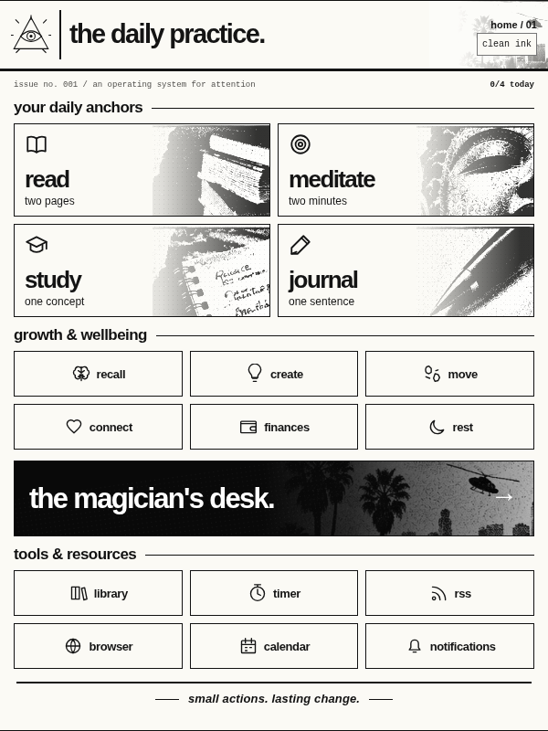

# the daily practice.

*A quiet habit dashboard and a magician's rehearsal desk.*

**Status:** v0.3 underground-edition browser prototype + **experimental, disabled-by-default KOReader bridge**. This repository is a private-development starter, **not** an installed Kindle operating system, a completed jailbreak package, or a working KOReader-to-browser sync.



The visual direction mixes tightly organized modernist layouts with a monochrome underground editorial feel: lowercase headings, restrained occult imagery, strong contrast and minimal e-ink motion. Inspired by behavioral principles from *Atomic Habits*, independently designed; **not affiliated with James Clear, VICE or Dieter Rams**.

## Quick start: Chrome on your MacBook

1. Open `dashboard/index.html` in Chrome. No packages or account are required.
2. For more consistent browser storage, run `python3 -m http.server 8000 --directory dashboard` **from this repository root** and open http://localhost:8000.
3. Explore **the magician's desk → stack trainer**. The starter deck is ordinary new-deck order, not a claimed memorized stack.
4. Export your private data periodically from **notifications → export private data / settings**.

Keep using the same URL and browser profile or local storage may appear to vanish. The JSON export **does not contain ebook file blobs**; back up your original ebooks separately.

## What's working / what's planned

| Area | Current state |
|---|---|
| Underground dashboard + clean ink toggle | **Works in recent Chrome**, not verified in Kindle's browser |
| read / meditate / study / journal / growth widgets | **Works in prototype**; automatic checkmarks are based on actions inside dashboard |
| magician's desk: stack trainer, script rehearsal, effect knowledge | **Works in prototype** with locally stored data |
| library | TXT read/search, PDF via Chrome; EPUB storage/export, **not native EPUB reading** |
| timer, RSS, bookmarks/browser | **Works with limitations**: RSS network fetch depends on CORS, timers require an open page, browser launches an external tab/window |
| KOReader integration | **Experimental code only; disabled by default, no dashboard sync** |
| KOReader → read checkmark | **Not implemented end-to-end** |
| offline generative LLM | **Not implemented**; Ask Book currently uses local TXT passage search |
| native Kindle launcher or refresh-waveform control | **Not implemented** |

## Layout of this repository

```text
.
├── dashboard/                           # existing v0.3 underground Chrome prototype
│   ├── index.html
│   ├── app.js
│   ├── style.css
│   ├── assets/                       # bundled, compressed grayscale artwork
│   └── tools/epub_to_txt.py          # offline DRM-free EPUB → TXT helper
├── integrations/koreader/
│   └── dailypractice.koplugin/       # EXPERIMENTAL; main.lua is disabled by default
├── tests/                            # stdlib Python tests + Lua smoke harness
├── docs/                             # project direction, setup, safety, source history
├── .github/workflows/checks.yml      # read-only checks (optional GitHub Actions)
└── README.md
```

## First milestones

1. Preserve stable Chrome v0.3 while setting up version control.
2. Validate KOReader plugin events in a desktop emulator or with mock tests.
3. Safely opt in to a **separate**, rollbackable Kindle plugin test.
4. Build a **read-only bridge** from a KOReader progress record to dashboard state; don't assume the Kindle browser can access KOReader settings.
5. Test actual Kindle screen refresh, battery and sleep behavior before native launcher work.

For source tests, use `python3 -m unittest discover -s tests -v`, `node --check dashboard/app.js`, and (with Lua available) `lua tests/test_koreader_mock.lua`. These tests simulate behavior; they do not verify a physical Kindle.

For safe testing, see [docs/KINDLE-SAFETY.md](docs/KINDLE-SAFETY.md). To upload this repository to GitHub, see [docs/GITHUB-SETUP.md](docs/GITHUB-SETUP.md). A fuller features reference is in [docs/DASHBOARD-V0.3-README.md](docs/DASHBOARD-V0.3-README.md).

**Privacy:** No private journals, scripts, ebooks, bookmarks, KOReader databases, tokens, credentials, or device dumps are included in this repository. Don't add those to Git history.

**Licensing:** This starter repository does not assign an open-source license. The dashboard artwork was generated for this project. KOReader and any upstream code have their own licenses; this repository does not bundle KOReader's core source.
